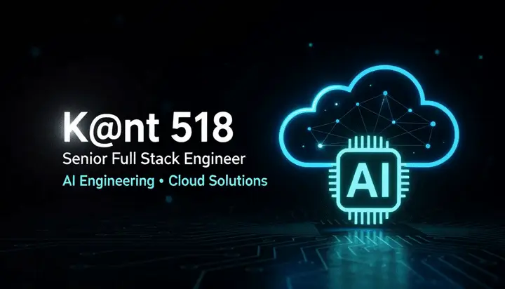
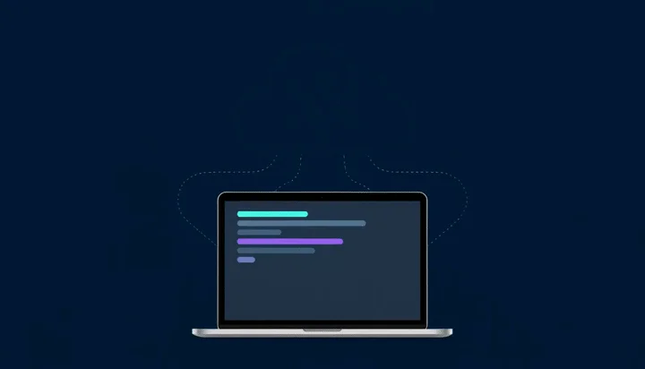

<!-- ═══════════════════════════  HEADER  ═══════════════════════════ -->

  

 

 

<!-- ═══════════════════════════  ABOUT  ═══════════════════════════ -->

## About Me

I'm **K@nt 518**, a **Senior Full Stack Engineer** focused on **AI Engineering** and **Cloud Solutions**.

I build production-ready products end-to-end: from intelligent backends and LLM-powered features to scalable cloud infrastructure and polished user interfaces.

- 🤖 **AI Engineering**: LLM apps, RAG pipelines, AI agents and model integration
- ☁️ **Cloud Solutions**: scalable, secure and cost-efficient architectures on AWS, Azure and GCP
- 🧩 **Full Stack**: clean APIs, modern frontends and reliable data layers
- ⚙️ **DevOps**: containers, CI/CD and infrastructure as code
- 🎯 **Mindset**: automate the boring, simplify the complex, ship what matters

 

 

<!-- ═══════════════════════════  TECH STACK  ═══════════════════════════ -->

## Tech Stack

<table align="center">
  <tr>
    <td align="center" width="150"><b>AI & ML</b></td>
    <td>
       
      
      
      
      
      
    </td>
  </tr>
  <tr>
    <td align="center"><b>Cloud & DevOps</b></td>
    <td></td>
  </tr>
  <tr>
    <td align="center"><b>Backend</b></td>
    <td></td>
  </tr>
  <tr>
    <td align="center"><b>Frontend</b></td>
    <td></td>
  </tr>
  <tr>
    <td align="center"><b>Data</b></td>
    <td></td>
  </tr>
</table>

 

<!-- ═══════════════════════════  STATS  ═══════════════════════════ -->

## GitHub Analytics

 

 

<!-- ═══════════════════════════  CONTRIBUTIONS  ═══════════════════════════ -->

## Contribution Graph

<picture>
  <source media="(prefers-color-scheme: dark)" srcset="https://raw.githubusercontent.com/kant131/kant131/output/pacman-contribution-graph-dark.svg" />
  <source media="(prefers-color-scheme: light)" srcset="https://raw.githubusercontent.com/kant131/kant131/output/pacman-contribution-graph.svg" />
  
</picture>

 

<!-- ═══════════════════════════  CONNECT  ═══════════════════════════ -->
<!--
  Add your links here and remove the comment markers to show this section:

## Let's Connect

  
  
  
  

-->

<!-- ═══════════════════════════  FOOTER  ═══════════════════════════ -->

Thanks for stopping by. Let's build something intelligent together.

