<!-- ═══════════════════════════  HEADER  ═══════════════════════════ -->

  

<!-- ═══════════════════════════  ABOUT  ═══════════════════════════ -->

## About Me

 

<!-- ═══════════════════════════  TECH STACK  ═══════════════════════════ -->

 

<!-- ═══════════════════════════  CONTRIBUTIONS  ═══════════════════════════ -->

<!-- counts profile views for the stats card above; must load on the page -->

